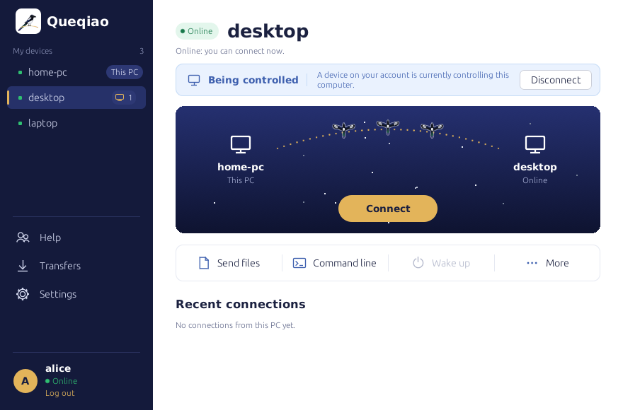
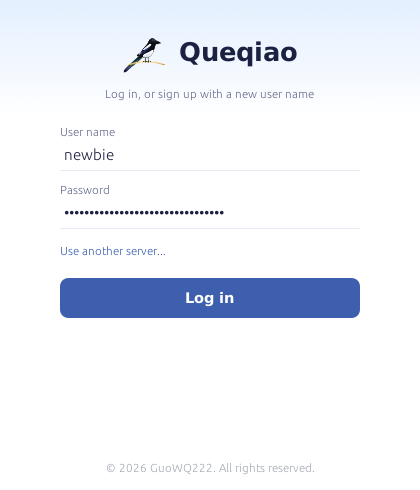

  

<h1 align="center">Queqiao</h1>

<strong>English</strong> · <a href="README.zh-CN.md">简体中文</a>

  <b>Remote control for your own computers, from your computer or your phone.</b> 
  Log in, see your devices, and control any of them from another. Devices prefer a direct connection and can also connect through a relay server.

  
  
  
  

  

<i>Named after the magpie bridge (鹊桥) of the Qixi legend, which joins two people across the Milky Way.</i>

---

## Contents

- [Features](#features)
- [Getting started](#getting-started)
- [Compatibility](#compatibility)
- [Questions & Feedback](#questions--feedback)
- [License](#license)

---

## Features

<table>
  <tr>
    <td width="33%" valign="top">
      <h4>🔗 Connect anywhere</h4>
      Direct peer-to-peer connections across networks (NAT traversal, IPv4 and IPv6). When a direct connection is unavailable, the session uses a relay server (50–100 ms latency).
    </td>
    <td width="33%" valign="top">
      <h4>🎞️ Sharp, fast picture</h4>
      Hardware encoding on NVIDIA, Intel and AMD GPUs: H.264, H.265 (with 4:4:4 colour and 10-bit) and AV1, with adaptive bitrate. A software fallback runs on any PC.
    </td>
    <td width="33%" valign="top">
      <h4>👥 One controller at a time</h4>
      When another of your devices is in control, Queqiao says so. You can disconnect it, or take control after confirming.
    </td>
  </tr>
  <tr>
    <td valign="top">
      <h4>📁 Files and clipboard</h4>
      A two-pane file transfer window, drag and drop, and text, images and files through the clipboard, both ways.
    </td>
    <td valign="top">
      <h4>🤝 Help someone</h4>
      Help a person on another account with their help ID and code. They see who is helping and can end it at any time.
    </td>
    <td valign="top">
      <h4>🔒 Security first</h4>
      Signed signalling between device keys, a pinned server certificate, consent on the controlled computer, a privacy screen and encrypted saved logins.
    </td>
  </tr>
</table>

---

## Getting started

<table>
  <tr>
    <td width="300" valign="top"></td>
    <td valign="top">

1. **Log in.** Open Queqiao and enter a user name and password. If the user name is new, the account is created and you are signed in. If it already exists, the password is checked.
2. **Add your computers.** Install Queqiao on each computer and log in with the same account. Each one appears in **My devices**.
3. **Connect.** Choose a device and press **Connect**. If another of your devices is controlling it, you are asked whether to take control, and the other session ends only if you confirm.
4. **Use the session.** The session bar at the top opens the **control center** (picture, sound, screens, input, tools), the **file transfer** window, full screen and **End**.
5. **Help someone.** They choose *Let someone help me* and read you their help ID and code. You enter them under **Help someone**.

</td>
  </tr>
</table>

Sessions on a phone work the same way. Choose a device and tap **Connect**. Tap or drag to move the pointer, or switch to mouse mode. Use the floating ball for the keyboard, keys and tools.

---

## Compatibility

### Platforms

| Platform | Versions | Control other devices | Be controlled |
|---|---|:---:|:---:|
| **Windows** | Windows 10 (1809 or later), Windows 11; x64 | ✅ | ✅ including the sign-in screen, with the service |
| **Linux** | glibc 2.35 or later (Ubuntu 22.04+, Debian 12+, Fedora 36+); x86_64 | ✅ | ✅ on X11 and Wayland, including the sign-in screen, with the service |
| **Android** | Android 8.0 or later | Coming soon | ❌ Not supported |
| **iOS / iPadOS** | iOS 15 or later | Coming soon | ❌ Not supported (iOS does not allow apps to remotely control the device) |

### Linux desktops

| Session | Screen and input |
|---|---|
| X11 (any desktop) | ✅ MIT-SHM capture, XTest input |
| Wayland: GNOME | ✅ through the desktop portal. The person allows it once; the permission is remembered |
| Wayland: wlroots (Sway and others) | ✅ screen through the desktop portal, input through the compositor's virtual pointer and keyboard |
| Wayland: KDE Plasma | ⚠️ Unstable, untested |

### Graphics and codecs

Queqiao automatically selects a video format that both ends support. You can also choose one in the session's control center. Available formats depend on the GPU model and driver.

| Platform | GPU vendor | Encoding (controlled computer) | Decoding (controller) |
|---|---|---|---|
| **Windows** | NVIDIA | NVENC (H.264, H.265, AV1) | NVDEC (H.264, H.265) |
| **Windows** | Intel | Quick Sync / oneVPL (H.264, H.265) | oneVPL (H.264, H.265) |
| **Windows** | AMD | AMF (H.264, H.265) | AMF (H.264, H.265) |
| **Windows** | Any vendor | Media Foundation (H.264, H.265, AV1) | Media Foundation (H.264, H.265, AV1) |
| **Linux** | NVIDIA | NVENC (H.264, H.265, AV1) | NVDEC (H.264, H.265, AV1) |
| **Linux** | Intel, AMD and others | OpenH264 (H.264, software) | OpenH264 (H.264, software) |

On Windows, AV1 decoding uses Media Foundation across vendors. Both desktop platforms can encode and decode H.264 on the CPU with OpenH264.

Planned mobile controllers use the system decoder on Android (MediaCodec) and iOS/iPadOS (VideoToolbox).

#### Colour

| Session codec | Chroma sampling and bit depth |
|---|---|
| H.264 | 4:2:0, 8-bit |
| H.265 (NVIDIA NVENC/NVDEC, Intel oneVPL) | 4:2:0 or 4:4:4, each at 8 or 10 bits |
| H.265 (AMD AMF) | 4:2:0, 8 or 10 bits |
| H.265 (Windows Media Foundation) | 4:2:0, 8-bit |
| AV1 | 4:2:0, 8-bit |

Desktop video uses limited-range BT.709. When both ends support it, you can enable H.265 4:4:4 in the session's control center to preserve the edges of small coloured text and fine lines.

### Network

Direct connections work across most home and office networks, over IPv4 or IPv6. When no direct path exists, for
example behind a phone's hotspot, the session is relayed through your server. Proxies and VPN adapters on the
computer are bypassed for the server connection.

---

## Questions & Feedback

- **Questions, problems and ideas:** open an [issue](https://github.com/GuoWQ222/Queqiao/issues). For a problem, include what you did, what happened, your system and Queqiao's version (`queqiao-agent --version`).

---

## License

Copyright © 2026 GuoWQ222. **All rights reserved. Infringement may result in legal action.**

You may download, install and run Queqiao for your own use. Redistribution or sale of any part of Queqiao
requires the copyright holder's prior written permission. This covers free redistribution, download mirrors
and sales of Queqiao on its own or bundled with a paid product. It applies to original and modified versions. See [LICENSE](LICENSE).

The third-party parts (a patched sctp-proto, bindings generated from NVIDIA's, Intel's and AMD's MIT-licensed
headers, and the crates compiled in) keep their own licences: see [THIRD_PARTY_NOTICES.md](THIRD_PARTY_NOTICES.md).
