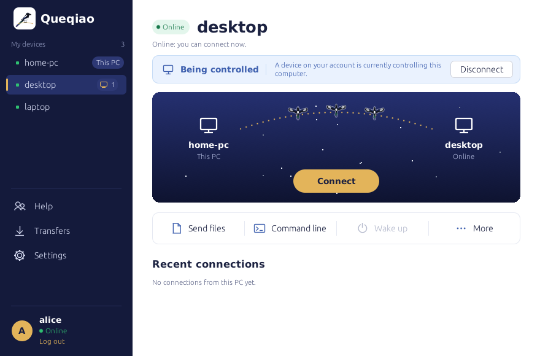
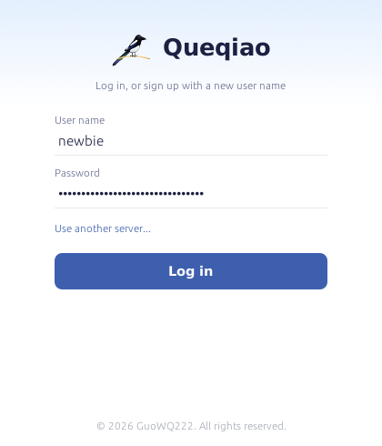

<p align="center">
  
</p>

<h1 align="center">Queqiao</h1>

<p align="center"><a href="README.md">English</a> · <strong>简体中文</strong></p>

<p align="center">
  <b>用电脑或手机，远程控制自己的电脑。</b><br>
  登录后即可查看自己的设备，选择一台发起连接。设备优先直连，也可以通过自己的服务器中转。
</p>

<p align="center">
  
  
  
  
</p>

<p align="center">
  
</p>

<p align="center"><i>Queqiao 的名字来自七夕传说中的鹊桥。喜鹊在银河上架起桥，让牛郎和织女得以相会。</i></p>

---

## 目录

- [主要功能](#主要功能)
- [安装与使用](#安装与使用)
  - [安装](#安装)
  - [快速上手](#快速上手)
  - [自建服务器](#自建服务器)
  - [从源码构建](#从源码构建)
- [兼容性](#兼容性)
- [问题与反馈](#问题与反馈)
- [许可](#许可)

---

## 主要功能

<table>
  <tr>
    <td width="33%" valign="top">
      <h4>🔗 跨网络连接</h4>
      通过 NAT 穿透建立点对点连接，支持 IPv4 和 IPv6。无法直连时，自动通过你的服务器中转。
    </td>
    <td width="33%" valign="top">
      <h4>🎞️ 高清低延迟画面</h4>
      可用 NVIDIA、Intel 和 AMD 显卡进行硬件编码。支持 H.264、H.265（含 4:4:4 色度采样和 10 位色深）、AV1 及自适应码率。没有可用的硬件编码器时，可使用软件编码。
    </td>
    <td width="33%" valign="top">
      <h4>👥 会话接管</h4>
      同一时间只有一台设备可以控制目标电脑。如果你的另一台设备正在控制它，Queqiao 会显示提示。你可以断开现有连接，也可以确认后接管。
    </td>
  </tr>
  <tr>
    <td valign="top">
      <h4>📁 文件与剪贴板</h4>
      在双栏文件传输窗口中拖放文件，也可以通过剪贴板双向传送文字、图片和文件。
    </td>
    <td valign="top">
      <h4>🤝 远程协助</h4>
      使用对方提供的帮助 ID 和验证码，即可跨账号发起协助。对方可以看到谁在协助，也可以随时结束会话。
    </td>
    <td valign="top">
      <h4>🔒 连接安全</h4>
      设备用各自的密钥为连接信令签名，并校验预先指定的服务器证书。被控端可以要求连接前征得同意，也可以启用隐私屏。保存的登录信息会加密存储。
    </td>
  </tr>
</table>

### 功能详情

- **账号与设备**　登录和注册共用一个窗口。可查看设备的在线状态、为设备命名或添加收藏，也可以借助同一局域网内的另一台设备远程唤醒电脑（Wake-on-LAN）。
- **会话管理**　可以同时连接多台电脑。每个会话都有悬浮工具栏和控制中心，可查看连接路径、延迟、帧率和实时传输速率。
- **画面**　可调整画质、帧率、分辨率和码率，支持多显示器和全屏。开启隐私屏后，被控电脑的屏幕变暗，本地键盘和鼠标停用。
- **声音**　通过 Opus 传送被控电脑的声音，收听时被控电脑的扬声器会静音。
- **键鼠输入**　支持鼠标、键盘扫描码和 Windows 快捷键，包括 Win、Alt+Tab，以及安装服务后可用的 Ctrl+Alt+Del。还支持游戏鼠标相对移动、远端指针样式、自定义快捷键和一键隐藏窗口的老板键。
- **远程工具**　可在终端窗口运行远程命令行，将终端从界面分离、重新显示或重命名，也可远程锁定或重启电脑。
- **被控端权限**　电脑前的用户可以决定是否允许自己的其他设备连接、连接前是否需要确认，以及是否开放剪贴板、文件和命令行。还可以设置开机自启、会话结束后锁屏，并用密码保护这些设置。
- **登录界面**　安装可选服务后，远程端也能看到登录、锁屏、Ctrl+Alt+Del 和 UAC 提示界面。
- **手机控制**　Android 和 iOS 客户端可远程控制电脑。支持触控和鼠标模式、手机键盘多语言输入、快捷键栏、多显示器切换，以及播放电脑声音。
- **更新**　Windows 在会话间隙安装经过签名的更新。如果新版本无法启动，会自动回滚。Linux 可直接安装新软件包来升级。
- **界面语言**　支持英文和简体中文，可跟随系统，也可在设置中手动选择。

完整功能清单见[与 UU 远程的逐项对照](docs/PARITY.md)。

---

## 安装与使用

### 安装

| 平台 | 安装包 | 安装方法 |
|---|---|---|
| **Windows** | `queqiao-setup-0.1.0.exe` | 双击运行，为当前用户安装。安装可选服务时需要确认一次 UAC 提示。静默安装命令为 `queqiao-setup-0.1.0.exe --quiet --autostart [--service]`。 |
| **Ubuntu、Debian** | `queqiao_0.1.0_amd64.deb` | `sudo apt install ./queqiao_0.1.0_amd64.deb` |
| **Fedora、openSUSE Tumbleweed** | `queqiao-0.1.0-1.x86_64.rpm` | Fedora 使用 `sudo dnf install ./queqiao-0.1.0-1.x86_64.rpm`，openSUSE 使用 `sudo zypper install ./queqiao-0.1.0-1.x86_64.rpm`。 |
| **Android** | `queqiao.apk` | 在手机上打开安装包，并允许从该来源安装应用。 |
| **iOS** | `Queqiao.ipa` | 使用 [Sideloadly](https://sideloadly.io) 和自己的 Apple ID 安装。按 Apple 要求，每 7 天需要重新签名。 |

> [!NOTE]
> Releases 页面暂未提供预编译安装包，可按下文的[从源码构建](#从源码构建)自行构建。Windows 程序目前使用测试证书签名，首次启动时 SmartScreen 可能会显示提示。

### 快速上手

<table>
  <tr>
    <td width="300" valign="top"></td>
    <td valign="top">

1. **登录。** 打开 Queqiao，输入用户名和密码。如果用户名尚未注册，系统会创建账号并登录。如果账号已存在，系统会验证密码。
2. **添加电脑。** 在每台电脑上安装 Queqiao，用同一账号登录。它们会出现在「我的设备」中。
3. **发起连接。** 选择目标设备，点击「连接」。如果你的另一台设备正在控制它，系统会询问是否接管，确认后才会结束原会话。
4. **使用工具栏。** 从顶部会话栏打开「控制中心」调整画面、声音、显示器和输入设置，或使用远程工具。也可以打开「文件传输」、切换全屏，或点击「结束」断开连接。
5. **帮助别人。** 请对方选择「让别人帮助我……」，把帮助 ID 和验证码告诉你。在你的设备上选择「帮助别人」，输入对方提供的信息。

</td>
  </tr>
</table>

在手机上同样是选择设备后点「连接」。轻点或拖动屏幕即可移动指针，也可以切换到鼠标模式。点击悬浮球可调出键盘、快捷键和工具。

### 自建服务器

Queqiao 服务器管理账号和设备列表，转发建立会话所需的信令，并在设备无法直连时中转会话。小型云服务器即可运行。

```sh
# 生成证书，并打印客户端所需的证书指纹
queqiao-server init --name <public address>

# 可选：手动创建账号，密码从标准输入读取
queqiao-server add-user <name>

# 启动服务；加上 --allow-signup 后，可在登录窗口注册新账号
queqiao-server serve --name <public address> --public-ip <public address> --allow-signup
```

开放 **TCP 47100**（账号服务）、**UDP 3478**（STUN/TURN）和 **UDP 47200–47399**（会话中转）。省略 `--allow-signup` 时，仅通过 `add-user` 创建的账号可以登录。启用后，可在登录窗口输入新用户名注册，每个来源地址每小时最多注册 3 个账号。客户端通过服务器地址和证书指纹连接，两者都可以预先写入安装包，详见[开发文档](docs/DEVELOPMENT.md)。

### 从源码构建

```sh
git clone https://github.com/GuoWQ222/Queqiao.git
cd Queqiao
cargo build --release --workspace
```

Windows 需要 Visual Studio Build Tools（C++ 工作负载和 CMake）以及 NASM。Linux 需要 clang、CMake、NASM，以及 X11、Wayland、PipeWire 和 PulseAudio 的开发包。Windows 使用 `scripts\package.ps1` 生成安装包，Linux 使用 `scripts/package_linux.sh`。仓库结构、检查和测试方法见[开发文档](docs/DEVELOPMENT.md)。

---

## 兼容性

### 平台

| 平台 | 版本 | 作为主控端 | 作为被控端 |
|---|---|:---:|:---:|
| **Windows** | Windows 10（1809 或更高版本）、Windows 11，x64 | ✅ | ✅ 安装服务后也可访问登录界面 |
| **Linux** | glibc 2.35 或更高版本（Ubuntu 22.04+、Debian 12+、Fedora 36+），x86_64 | ✅ | ✅ 支持 X11 和 Wayland，安装服务后也可访问登录界面 |
| **Android** | Android 8.0 或更高版本 | ✅ | 计划支持 |
| **iOS / iPadOS** | iOS 15 或更高版本 | ✅ | 不支持，iOS 不允许应用远程控制本机 |

### Linux 桌面环境

| 会话类型 | 画面采集与输入 |
|---|---|
| X11（任意桌面） | ✅ 通过 MIT-SHM 采集画面，通过 XTest 处理输入 |
| Wayland（GNOME） | ✅ 通过桌面门户采集画面并处理输入，用户首次授权后会记住权限 |
| Wayland（wlroots，如 Sway） | ✅ 通过桌面门户采集画面，通过合成器的虚拟指针和键盘处理输入 |
| Wayland（KDE Plasma） | ⚠️ 使用桌面门户，输入已通过测试，画面采集仍在测试中 |

### 显卡与编解码器

Queqiao 会检测两端电脑可用的编解码器，并在需要时逐级回退。没有独立的硬件编解码能力时，也可以通过软件完成编码和解码。

| 硬件 | 编码（被控端） | 解码（主控端） |
|---|---|---|
| **NVIDIA** | NVENC，支持 H.264、H.265（4:2:0 / 4:4:4，8 / 10 位）和 AV1 | NVDEC |
| **Intel** | Quick Sync（oneVPL），支持 H.264、H.265 | oneVPL |
| **AMD** | AMF，支持 H.264、H.265 | AMF |
| **其他** | Media Foundation（Windows）、OpenH264（软件编码） | Media Foundation、OpenH264 |
| **手机** | — | 系统硬件解码器（MediaCodec、VideoToolbox） |

默认自动选择两端共同支持的最佳编解码器，也可在会话控制中心手动指定。Linux 目前支持使用 NVIDIA 显卡进行硬件编解码，其他显卡使用软件编解码。

### 网络

在大多数家庭和办公网络中，设备可通过 IPv4 或 IPv6 直连。如果网络条件限制直连（例如使用手机热点时），会话会通过你的服务器中转。连接服务器时，Queqiao 会绕过本机代理和 VPN 网卡。

---

## 问题与反馈

- 如有疑问、遇到故障或有改进建议，欢迎[提交 Issue](https://github.com/GuoWQ222/Queqiao/issues)。报告故障时，请附上操作步骤、实际结果、操作系统和 Queqiao 版本（运行 `queqiao-agent --version` 查看）。
- 如果发现安全问题，请先开一个 Issue 询问私下联系方式，再通过私下渠道提供细节。

---

## 许可

版权所有 © 2026 GuoWQ222，保留所有权利。未经著作权人书面许可，不得复制、修改、分发或使用 Queqiao 的任何部分。详见[许可文件](LICENSE)。

第三方组件各自遵循原有许可证，包括打过补丁的 sctp-proto、从 NVIDIA、Intel 和 AMD 以 MIT 许可证发布的头文件生成的绑定，以及编译进程序的 Rust 依赖。详见[第三方声明](THIRD_PARTY_NOTICES.md)。
